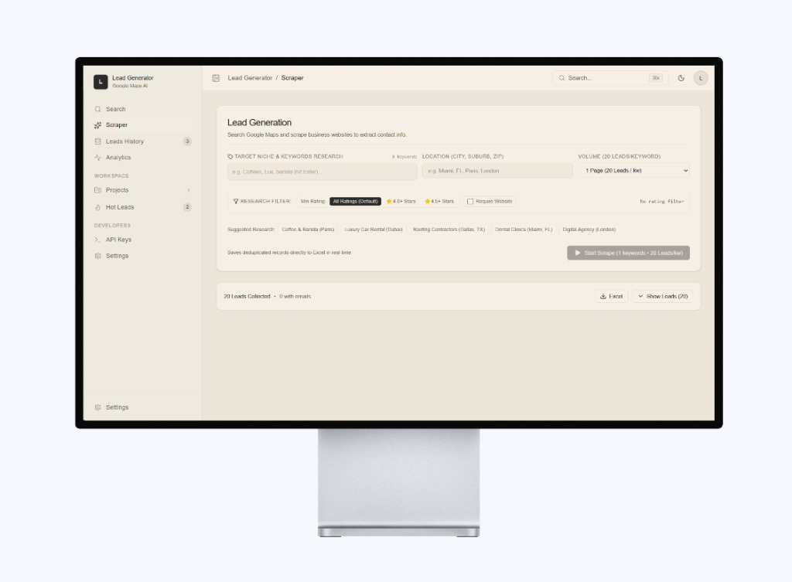

<div align="center">

# 🌐 Google Maps AI Lead Generator & Enricher

**High-Performance B2B Lead Scraping, Multi-Keyword Research, and AI-Powered Contact Enrichment**

[](https://fastapi.tiangolo.com/)
[](https://react.dev/)
[](https://www.typescriptlang.org/)
[](https://tailwindcss.com/)
[](https://aistudio.google.com/)
[](https://playwright.dev/)
[](LICENSE)

<br />

<p align="center">
  
</p>

<p align="center">
  <em>An editorial, high-prestige lead extraction workstation designed for agency owners, growth hackers, and sales teams.</em>
</p>

</div>

---

## ⚡ Overview

**Google Maps AI Lead Generator** is a production-ready, full-stack platform that transforms local business discovery into an automated sales intelligence engine. It searches Google Maps across multiple target keywords, crawls official business websites with headless browsers, and extracts verified decision-maker emails, phone numbers, social media profiles, and operational hours using state-of-the-art LLMs.

---

## ✨ Key Features

### 🔍 Multi-Keyword Targeting & Deep Geo-Discovery
- **Multi-Keyword Research**: Enter comma-separated tags or press `Enter` to search multiple niches simultaneously (e.g., `Coffees`, `Luxury`, `Barista`).
- **Global Geocoding Support**: Target any city, state, postal code, or country worldwide with built-in latitude/longitude resolving.
- **Configurable Search Volume**: Paginate dynamically from 20 up to 100+ leads per keyword in a single job.

### 🧠 AI-Powered Contact & Social Enrichment
- **Multi-LLM Engine**:
  - **Google Gemini** (`gemini-3.5-flash-lite` — ultra-fast, free tier via Google AI Studio).
  - **Groq Cloud** (sub-second Llama 3.3 70B inference).
  - **OpenRouter & OpenAI** (universal model support).
  - **Smart Regex Heuristic Fallback** (zero-key mode for offline or unauthenticated scraping).
- **Comprehensive Lead Data**:
  - **Direct Websites**: Clean, protocol-normalized clickable URLs.
  - **Verified Emails**: 1-click copy button with instant visual feedback.
  - **Phone Numbers**: Formatted international contact numbers.
  - **Brand Social Profiles**: Native SVG icons for **Instagram**, **Facebook**, **LinkedIn**, and **X / Twitter**.
  - **Structured Opening Hours**: Fully parsed Monday–Sunday schedule formatted for human readability.
  - **Ratings & Reviews**: Live Google ratings and total review counts.

### 🎯 Sales Pipeline & Hot Leads Management
- **Hot Leads Bookmarking**: Select high-intent prospects via checkboxes and move them directly to the **Hot Leads** workspace.
- **Expandable Live Stream**: Clean collapsible/expandable table view (`Show Leads`) keeping your interface focused during active scrapes.
- **Stop & Resume Control**: Gracefully halt any active scraping job with one click — all completed leads are instantly preserved.
- **Instant Filtering**: Filter by minimum rating (`4.0+`, `4.5+`, or `All Ratings`), emails only, phone numbers, or websites.

### 💾 Local-First & Real-Time Auto-Save
- **Zero Data Loss**: Every lead is flushed directly to Excel (`.xlsx`) the second it is enriched.
- **Leads History Browser**: Inspect historical scrape sessions, search within datasets, and download spreadsheets anytime.
- **Privacy First**: All generated `.xlsx` datasets and your `.env` credentials are kept strictly local and `.gitignore` protected.

---

## 🚀 Quick Start

### 1. Prerequisites
- **Python 3.9+**
- **Node.js 18+** (only needed if customizing frontend source code)
- A free **[Serper.dev](https://serper.dev/)** API key (includes 2,500 free searches)
- *(Optional)* A free **[Google AI Studio](https://aistudio.google.com/)** key for Gemini AI extraction

---

### 2. Clone & Setup

```bash
# Clone the repository
git clone https://github.com/5aled-jpeg/leads-generation.git
cd leads-generation

# Create and activate Python virtual environment
python -m venv venv

# Windows
.\venv\Scripts\activate

# macOS / Linux
source venv/bin/activate

# Install Python requirements
pip install -r requirements.txt

# Install Playwright browser engine
playwright install chromium
```

---

### 3. Configure API Credentials

Copy the `.env.example` template:
```bash
cp .env.example .env
```

Add your API keys to `.env` (or configure and test them directly inside the dashboard's **API Credentials** settings tab):
```env
SERPER_API_KEY=your_serper_api_key_here
GEMINI_API_KEY=your_gemini_api_key_here
LLM_MODEL=gemini-3.5-flash-lite
```

---

### 4. Launch Application

#### Option A: 1-Click Launch (Windows)
Double-click `run.bat` or run:
```powershell
.\run.bat
```

#### Option B: FastAPI Backend & React Dashboard
```bash
python server.py
```
Visit **[http://localhost:8000](http://localhost:8000)** in your browser.

#### Option C: Streamlit GUI
```bash
streamlit run app.py
```

#### Option D: Headless CLI
```bash
python main.py --location "Paris, France" --query "Specialty Coffee" --pages 1
```

---

## 📁 Repository Structure

```
leads-generation/
├── assets/
│   └── preview.jpg            # Dashboard mockup preview image
├── src/
│   ├── places_api.py          # Serper.dev Google Maps API engine
│   ├── web_scraper.py         # Playwright headless browser crawler
│   ├── business_info.py       # AI contact extraction & auto-saving logic
│   ├── data_export.py         # Excel (.xlsx) formatting & styling
│   └── utils.py               # Gemini, Groq, OpenRouter & OpenAI adapters
├── frontend/                  # React + TypeScript + Tailwind CSS UI
│   ├── src/components/
│   │   ├── ScraperTab.tsx     # Multi-keyword research & live results table
│   │   ├── LeadsTab.tsx       # Historical lead files inspector & search
│   │   ├── HotLeadsTab.tsx    # High-priority prospect pipeline
│   │   ├── SettingsTab.tsx    # In-app credential management & live test
│   │   └── AnalyticsTab.tsx   # Scraping metrics & performance
│   └── dist/                  # Compiled production web bundle
├── data/                      # Local Excel output files (.gitignored)
├── server.py                  # FastAPI high-performance application server
├── main.py                    # Standalone terminal CLI runner
├── app.py                     # Streamlit application
├── run.bat                    # 1-Click Windows launch script
├── requirements.txt           # Python dependencies
└── .gitignore                 # Privacy shield (protects .env & data/*.xlsx)
```

---

## 🔒 Security & Privacy

- **Safe By Default**: Personal search history and exported Excel spreadsheets in `data/` are automatically ignored by Git.
- **Zero Credential Leaks**: `.env` is blocked by default, ensuring your API keys are never published or pushed to GitHub.
- **In-App Connectivity Tester**: Verify your Serper and Gemini credentials with live status indicators without exposing key values.

---

## 📄 License

Distributed under the **MIT License**. See `LICENSE` for more information.
